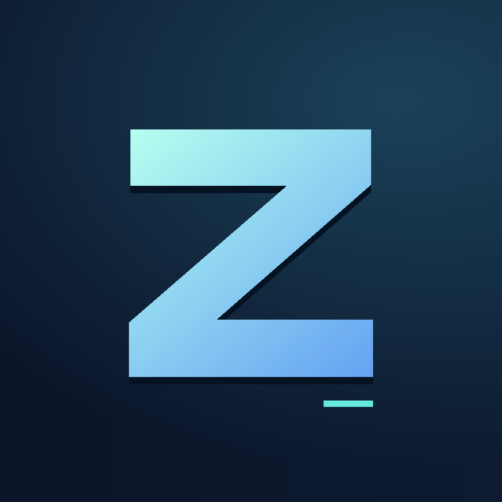
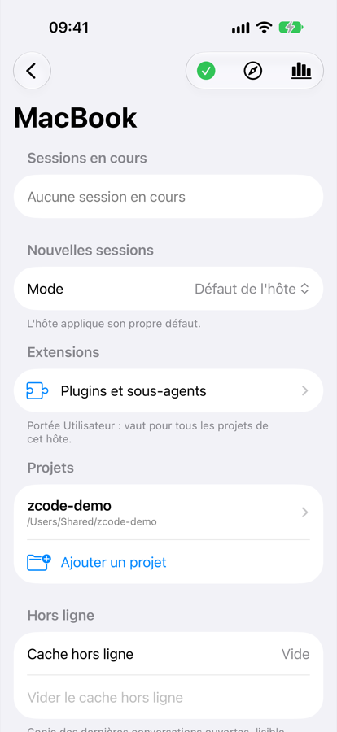
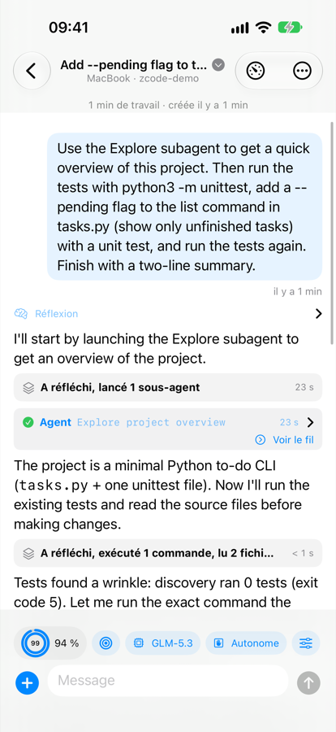
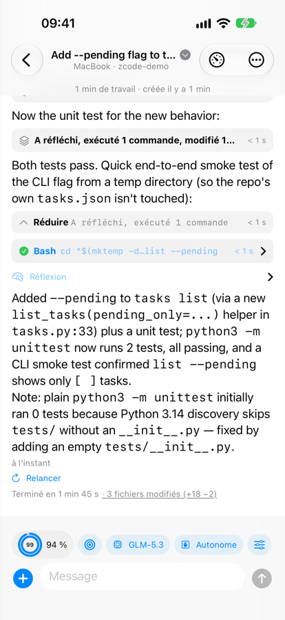
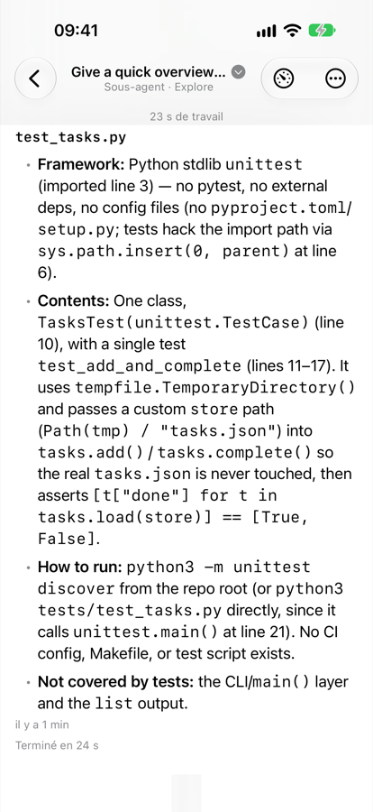
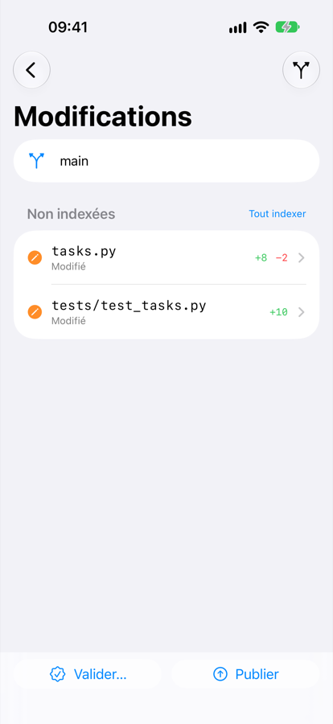

<p align="center">
  
</p>

<h1 align="center">ZCode iOS</h1>

<p align="center">
  A native iPhone client for <a href="https://github.com/zai-org/ZCode">ZCode</a>, Z.ai's coding agent:
  start, follow and steer your coding sessions from your pocket.
</p>

<p align="center">
  
  
  
  
  
</p>

> [!NOTE]
> The app's interface is currently in **French**. English and other languages are planned —
> see [`docs/localization-plan.md`](docs/localization-plan.md). Contributions welcome.

---

## Why

ZCode runs great on a computer, but agent sessions take time: they wait for a permission, ask a question, or finish
while you are away. ZCode iOS makes those sessions reachable from an iPhone with a **native SwiftUI** interface
instead of a web page in Safari.

The app is a client of the `zcode --web` server running on **your own machines**. It **never** talks to model APIs
directly: all GLM or Mistral traffic leaves from ZCode on the host, and the phone only drives it — privately, over
your [Tailscale](https://tailscale.com) tailnet.

```
iPhone ──wss (tailnet)──▶ tailscale serve ──▶ zcode --web (127.0.0.1:3030) ──▶ Z.ai / Mistral
```

## Features

**Conversation**
- Streaming answers with Markdown, syntax highlighting and math (KaTeX bundled, no network).
- Compact tool cards grouped per turn ("thought, ran 2 commands"), with diff, output and duration.
- Read-only sub-agent threads, in-conversation search, fork from a message, retry a response.
- Message times, session work time, offline reading of recent conversations.

**Composer**
- Model, effort and mode read from the server; `/` panel (commands, skills, sub-agents); favourite prompts.
- Attachments (photos, files), queue while a turn is running, sends that survive network drops.
- Quota rings: 5-hour window outside, weekly window inside.

**Agent interactions**
- Approval dock: permissions, multiple-choice questions, plans to approve or amend, masked sensitive input.
- Goals: long-running objectives verified by the model, with iterations, pause and resume.
- Saved workflows of the project, launched with their arguments and followed live.

**Project**
- Git changes: diff, stage, discard, commit (with a generated message if you like), push, switch branches.
- File browser on the host, and adding projects by browsing the host's folders.
- Extensions: marketplace plugins (install, configure, sources) and sub-agents (create, edit).

**Hosts**
- Several hosts (a Mac, a Linux box…): connection state, sessions waiting for you, default mode for new sessions.
- Coding Plan usage: remaining quota per window, resets, subscription.
- Archived, pinned and unread conversations; haptics at the end of a turn and on new requests.

## Architecture

| Layer | Role |
| --- | --- |
| `ZCodeWire` | 13-byte frames, tagged / VQL serializer |
| `ZCodeRPC` | RPC channels (100–103 / 200–204), calls and events |
| `ZCodeV4` | Pure V4 protocol, no I/O: tolerant snapshots, `TopicStore`, CAS commands |
| `ZCodeClient` | WebSocket transport, handshake, `git`, `file`, `usage-stats`, extensions clients… |
| `ZCodeAppCore` | All app logic (`@MainActor @Observable`), tested against a fake server |
| `App/` | Thin SwiftUI views |

Each layer only depends on the previous one. Decoding is tolerant: an unknown type from the server is kept and shown
raw, never a crash. Nothing that can come from the server is hard-coded (models, efforts, commands, approval options).
No external dependencies apart from the bundled KaTeX.

Swift 6 with strict concurrency, iOS 26, project generated by [XcodeGen](https://github.com/yonaskolb/XcodeGen).

## Getting started

You need a Mac with Xcode 26+, an iPhone on iOS 26+, a [Tailscale](https://tailscale.com) tailnet with both devices,
and access to a model provider supported by ZCode (e.g. the GLM Coding Plan).

### 1. Set up a host

On macOS (the host can be the same Mac you build with):

```sh
brew install mise xcodegen
host/install-zcode.sh v3.15.1 --activate              # builds ZCode from source and installs the web runtime
ZCODE_WORKSPACE=~/code host/macos/install-service.sh  # LaunchAgent + token + `tailscale serve`
```

Then, once: open `http://127.0.0.1:3030/?token=…` on the host (token in `~/.config/zcode-web/token`) and sign in to
your model provider. For a Linux host (systemd user service, SteamOS example), see
[`host/linux/README.md`](host/linux/README.md).

### 2. Install the app on your iPhone

```sh
cp Config/Signing.local.xcconfig.example Config/Signing.local.xcconfig
# edit it: your Apple team ID (a free "Personal Team" works) and a bundle identifier prefix of your own
scripts/install-device.sh                              # builds, installs and launches on the paired iPhone
```

One-time prerequisites: Apple ID in Xcode → Settings → Accounts, iPhone paired over USB, Developer Mode enabled on the
iPhone, and the developer approved in Settings → General → VPN & Device Management. With a free Apple account the
app expires after **7 days**: run the script again each week.

### 3. Add your host in the app

"Ajouter un hôte" (*Add a host*): a name, the tailnet address (`https://<machine>.<tailnet>.ts.net`) and the host's
token. The token grants shell access to the host: the app keeps it in the iOS Keychain only, and the server is only
exposed through `tailscale serve` (never `funnel`, never `0.0.0.0`).

## Keeping up to date

- **Host**: `host/update-zcode.sh <tag>` builds a new ZCode version without stopping the service, checks it on a
  spare local server, then switches over (automatic rollback if the check fails). `host/installed-version.txt`
  records the ZCode version this client is tested against.
- **iPhone**: `scripts/install-device.sh` (weekly with a free Apple account).

## Development

```sh
(cd Packages/ZCodeKit && swift test)        # protocol stack and app logic, runs on macOS
xcodegen generate
xcodebuild build -project ZCode.xcodeproj -scheme ZCode \
  -destination 'platform=iOS Simulator,name=iPhone 17 Pro' -derivedDataPath build/DerivedData
```

- [`CLAUDE.md`](CLAUDE.md): detailed architecture, commands, end-to-end UI journeys against a real host, the
  `zcode-probe` protocol tool, and established facts about the ZCode protocol.
- [`docs/limitations.md`](docs/limitations.md): known limitations and technical debt.
- [`docs/localization-plan.md`](docs/localization-plan.md): plan for English and other languages.
- [`Packages/ZCodeKit/Tests/Fixtures/README.md`](Packages/ZCodeKit/Tests/Fixtures/README.md): fixtures recorded
  against a real server.

Code comments are currently in French; identifiers, docs and commit messages are in English.

## License

[MIT](LICENSE). KaTeX is bundled under its own MIT license (`App/Resources/KaTeX/LICENSE`).

This is an independent project, not affiliated with Z.ai.
